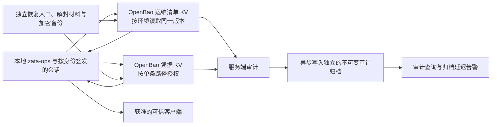

# PRD: 自部署 zata-ops 运维清单与凭据管理

> ✅ **交付前置**：无上游任务依赖。结构化声明见 §8 Delivery Dependencies。

> ⏸️ **验收状态**：验证阻塞。本行投影自 §9 Acceptance Checklist，阻塞和跟踪任务见 Final Reconciliation。

Part A 用于确认操作体验和权限边界。Part B 给出实现、迁移和验收计划。跟踪任务见 [Issue #5](https://github.com/ZataZhang/zata-ops/issues/5)。

## Feature Overview (功能一览)

以下是 §10 的功能摘要，行为以 §1 的样例为准。

- **换机后读取运维清单**（FR-1）。登录后按环境查询服务器、应用、服务和部署目标。
- **发布和回滚清单**（FR-2）。先校验和预览，发布时核对原版本，回滚也生成可追溯的版本。
- **一次任务可取多条凭据**（FR-3、FR-4）。服务端逐条授权和审计，任一条获取失败则任务停止。
- **区分人工查看与自动化**（FR-3、FR-4）。人按需查看单条，机器只拥有其工作负载所需的权限。
- **独立审计与恢复**（FR-5、FR-6）。凭据访问有可关联记录，生产记录归档后在留存期内不可删改。远端故障时可以从独立入口恢复。
- **逐项切换与本机兼容**（FR-7）。不同条目可分别迁移，生产切换前验证新值并安排旧值撤销。

# Part A · 人审层 (Review Layer)

## 1. Introduction & Goals

### Problem Statement

目前换一台工作站，需要单独复制真实资产清单和凭据文件。本机凭据以操作系统用户为隔离边界。同一账号下运行的程序可以读取整份文件，事后也难以确定实际读取了哪些凭据。服务器、服务地址和部署目标只保存在各自的本机清单时，操作者还可能用到不同版本。

### Interpretation (解读回显)

| 验证方式 | 输入 / 操作 | 期望观察到的结果 |
| --- | --- | --- |
| 👀 人审 + 自动验证 | 在一台无旧清单的新工作站登录开发环境，查询服务、预览应用检查和部署回滚 | 解析同一远端版本的清单，展示获授权的目标；查询和预览均不读取凭据，也不执行目标操作。 |
| 👀 人审 + 自动验证 | 以获授权身份运行一个确实需要两条凭据的任务，再由本人单独查看一条 | 任务只启动一次并收到两条值，审计端能分辨两次读取；人工查看单独留痕，值仅出现在本人交互终端。生产记录归档确认后，留存期内删除和缩短留存期均会被拒绝。 |
| 👀 人审 + 自动验证 | 以 Agent 身份请求生产凭据，或让任务的第二条凭据不可用 | 服务端拒绝越权；失败任务不启动。之前已发生的读取仍可追溯。 |
| 👀 人审 + 自动验证 | 远端停机后，从独立入口恢复并重新验证已迁移条目 | 无需依赖当前远端清单即可进入恢复流程；恢复并核对撤销记录后，有权身份可用，已撤销身份仍被拒绝。 |
| 🤖 自动验证 | 用纯本机配置运行现有命令 | 读取原有本机清单和凭据，保持原有契约；远端模式失败时即使磁盘有同名旧值也不会自动切回。 |

行为样例是 §7.6 验收判据的来源。修改样例就要同步修改对应判据。

**我默默定了这些**

- 以开发低权限服务跑通第一条链路，并用两条测试凭据验证批量取用。真实生产试点单独验证。
- 运维清单按环境授权；同一环境的服务器、服务和部署目标按同一发布版本使用。
- 人工查看界面默认一次展示一条。自动化可以在一次操作中取多条，权限和审计仍逐条生效。
- 本地保留连接、信任和设备身份信息。生产恢复入口和材料独立保管。
- 生产审计异步归档。存储确认后才标记为不可变，尚未归档的记录有积压监控和断流告警。
- 原有本机模式仍可显式选用。已迁移的条目始终走远端路径。

**我理解为不做**

- 网页管理台、远程通用命令执行平台，以及应用运行时配置中心的替换。
- 全局单次取密、全量导出凭据，以及对静态密码离开系统后的使用情况作审计承诺。

我的理解是，zata-ops 仍从本地运行，远端负责分发经授权的清单与凭据。如果有权任务取两条凭据时被数量限制阻断，或能读清单的身份顺手取得生产密码，都与目标不符。

- [ ] 我确认以上解读和行为样例。

### What The User Gets

操作者能在新机器恢复日常工作，按服务名找到连接信息并按需使用凭据。Agent 可以用自己的身份查询获授权的资产。维护者能追溯生产清单和凭据访问，并在远端故障时恢复。

### Measurable Objectives

- 无旧文件的客户端可以定位三类目标，清单查询的凭据读取次数为零。
- 两条获授权的凭据触发两次可关联的读取；第二条取不到时，子进程启动次数为零。
- 生产审计归档确认后，归档管理员提前永久删除或缩短留存期均失败，原记录仍可查。
- 生产恢复演练后，新会话可用，已撤销身份仍不能访问试点凭据。

## 2. Human Review Map (介入与风险地图)

### 生产配置和凭据由谁控制

建议让日常身份读取获准环境的清单，将生产清单发布、管理员凭据访问和恢复材料交给独立管理身份。清单能改变连接目标，开发工作站的日常 SSH 身份如果还能进入保险库宿主机管理面，应用层授权也挡不住它获取库里更多数据。

**请确认：** 是否接受生产发布、凭据管理与恢复采用独立入口，日常 Agent 默认只读获准的清单？

- [ ] 确认生产管理边界和 Agent 默认权限。

**验收：** 正常身份查得到获准清单，无法发布或获取生产凭据；专用管理身份可预览、发布及回滚获准的清单。

### 生产试点和停机恢复

建议先在开发环境验证权限和审计，再沿用专用短信凭据做已授权的生产试点。旧值撤销后，恢复应依靠新值或重新签发。远端停机时，维护者仍须能找到恢复所需的连接信息和材料。

**请确认：** 是否接受以上试点顺序，以及独立的不可变审计归档和隔离恢复演练作为生产启用条件？

- [ ] 确认试点顺序及生产启用条件。

**验收：** 真实服务试点保留脱敏回执和旧值撤销结果；留存期内对已归档记录的删除请求会被归档存储拒绝，隔离恢复后仍能查询历史访问，旧身份仍被拒绝。

**自动门禁，不需要逐项人工审阅**覆盖本机兼容、配置校验、批量失败、输出脱敏和审计故障。范围见 §11。

## 3. Usage And Impact After Implementation

| 角色 | 日常流程 | 兼容影响 |
| --- | --- | --- |
| 运维人员 | 在新工作站配置信任与登录方式，选环境、查目标。有需要时向可信客户端注入凭据，或在自己的交互终端查看单条。 | 现有本机用法可以继续显式使用。远端预览会先访问清单服务。 |
| Agent / 工作负载 | Agent 以独立身份读取获准清单。需要凭据的部署或服务用专用机器身份启动，将所需凭据交给可信进程。 | 持有机器取密会话的进程能够读取获授权的值，运行环境必须独立于不受信任的 Agent。 |
| 清单维护者 / 恢复人员 | 预览变更，发布新版本，必要时回滚。凭据故障时用独立入口恢复，核对权限、轮换与审计。 | 生产启用依赖独立的审计、恢复和凭据撤销验证。 |

## 4. Requirement Shape

| 要素 | 内容 |
| --- | --- |
| Actor | 运维人员、Agent、工作负载、清单维护者、恢复人员 |
| Trigger | 选择环境、查询或发布清单、使用或查看凭据、迁移或恢复 |
| Expected behavior | 由服务端按身份和资源授权。清单版本可追溯，多凭据任务逐条审计，失败时停止。 |
| Scope boundary | 现有 CLI、受控部署入口、独立审计与恢复。业务运行时参数继续由各应用现有配置系统管理。 |

# Part B · 执行器层 (Build Layer)

## 5. Repository Context And Architecture Fit

- CLI 入口在 `src/zata_ops/cli.py`。`src/zata_ops/local_cli.py` 提供 `service list/show` 和本地 `doctor`。服务、资产和部署目标解析分别在 `services.py`、`inventory.py`、`deploy/targets.py`。复用这些模型、目标解析、输出结构和现有命令。
- `scripts/diagnostics/private_services.py` / `private_secrets.py` 提供本机登记和子进程注入，后者已有多值执行与输出屏蔽逻辑。将可复用的执行部分下沉到安装包，保留原脚本入口。本机数据库服务解析在 `db/_service_connections.py`，当前部分入口依赖注入环境变量。
- `deploy/openbao/` 已有 TLS、Raft 和文件审计模板。现有操作员策略覆盖 `kv/*`，应用示例以运行时条目为授权单位。新增 zata-ops 策略和挂载时保留已部署应用的原访问契约。服务端负责认证、授权和审计，CLI 负责配置验证、选择和运行。
- **No frontend impact**。本次人机交互在现有 Typer CLI 内。实际 checkout 的业务代码位于 `src/zata_ops/`。
- **Existing PRD Relationship**。原地更新 Issue #5 对应的待办 PRD，沿用其跨平台客户端、短信试点、异机审计告警、轮换和恢复范围。已检查 `tasks/pending/` 与 `tasks/archive/`，未发现另一份负责相同投递链路的任务。现有 Swarm 节点切换计划使用独立部署入口，互不阻塞。

## 6. Recommendation

### Recommended Approach

复用仓库维护的 OpenBao 部署，在两个 KV v2 挂载提供清单和凭据。用户继续使用现有 CLI，新增显式远端配置入口。首版在同一部署内以挂载、环境和身份划分权限。宿主机管理员仍有控制面权限，独立的生产管理与异机审计保管用于约束这层风险。

### Proposed Solution Summary (实现机制)

操作者提供显式客户端 profile（连接配置），包括 HTTPS 入口、CA 信任、选定环境和挂载名。通过 OpenBao 原生流程取得短期会话，再由可信入口把 token 注入 CLI 进程环境。profile 与业务清单均不携带 token。清单写入者提供经校验的三个 TOML 文档，每个环境以单个 KV 条目整体发布。凭据写入者通过受控交互入口写入，以单独授权或审计的最小单元建 KV 路径。CLI 读取清单、校验引用，按调用需要逐条向同一 OpenBao 实例取值。

### Alternatives Considered

- 新建自部署 zata-ops API 和数据库会额外维护认证、策略、存储和审计；首版的清单 CRUD 和取密可由 OpenBao 提供。
- 清单放私有 Git 可以获得更丰富的差异审查。当前需求中，同一环境的原子快照、版本检查、回滚和共享只读访问可由 KV v2 支撑。
- 一次任务固定只能取一条会阻碍多凭据工作负载。把值合并到一个 runtime 条目又会把授权和审计粒度扩大到整条。默认使用独立路径，允许同一任务发起多次读取。

远端清单、授权、执行和审计需要在同一场端到端验收中观察。每次读取独立完成并记账，子进程只在全部读取成功后启动。开发验证到生产试点的顺序由轮换与故障影响决定。

## 7. Implementation Guide

本节根据当前仓库分析编写。实现发现遗漏的调用方、兼容约束、失败场景或更小的变更路径时，先更新 PRD 再继续。

### 7.1 Core Logic

1. **来源选择。** 根命令新增 `--profile PATH`。未指定时继续采用现有本地路径。显式远端 profile 与冲突的本地路径选择同时出现时报配置错误。远端仅允许经验证的 HTTPS，禁用跨源重定向和跳过证书校验。自动化使用生产凭据时，由工作负载独立配置允许的目标身份，再校验实际连接，例如数据库用受信任 CA 与已批准的主机名，SSH 复用本机已信任的主机密钥。通用注入入口由可信调用方负责选择和验证目标客户端。保留现有本机预览完全离线的行为。远端预览可以读取 OpenBao 中的清单，目标侧 HTTP、SSH 和 GitHub 派发保持禁用。
2. **按环境发布。** 在清单挂载下按环境划分条目，一个版本包含三份经过现有模型校验的 TOML。允许空的已声明清单；缺失文档、包含凭据的 URL、无效交叉引用和跨环境凭据引用报错。维护手册同时约束自由文本字段内的凭据和其他敏感内容。`config publish --from-dir DIR` 默认显示脱敏差异和当前版本，显式 `--apply --expected-version N` 才提交。OpenBao KV v2 CAS（基于原版本的条件写入）拒绝并发覆盖。`config rollback --to-version N` 读取指定旧版本，使用相同的预览、校验和 CAS 流程发布为新版本。每条命令只解析一份快照。服务器清单保留 SSH 身份引用，设备私钥路径和信任文件由本机映射。
3. **按身份读取。** 运维人员、Agent、机器工作负载、清单发布者、凭据维护者和恢复人员使用各自的 OpenBao 身份。开发演练可复用现有独立个人登录，生产高权用受约束的短期多因素会话，机器用逐工作负载 AppRole，审计可映射到各自身份。Agent 默认只读指定环境清单。专用机器角色只允许读显式授予的凭据路径，无全库列举和策略写入。清单作者无权扩大角色授权。生产管理会话、宿主机管理权限与恢复材料隔离于日常开发账号。
4. **按引用取用。** 在服务记录新增远端相对 `credential_ref`，与本地 `password_env` 的查值职责分别处理，保留现有本地条目结构。远端引用由 profile 环境和受控路径拼成，拒绝绝对路径、跨环境范围及路径转义。查询记录为“引用已登记”，凭据是否存在及可读留待实际取用。远端 `service run --credential SERVICE:ENV_NAME ... -- COMMAND` 支持重复选项，先校验变量名、保留名和重复绑定，再逐个读取不同的凭据路径。任一请求失败就丢弃已读取的值，任务不启动。复用安装包内的子进程执行逻辑，无 shell 解析，默认关闭输出和输入。远端执行给子进程构造最小系统环境和已选绑定，OpenBao 会话和其他凭据不继承。本机执行保留原有环境契约。命令用脱敏原因区分配置错误、取密失败和子进程结果。任意命令注入授予调用方接触明文的能力，只在可信会话使用。人工查看沿用 OpenBao 原生交互入口，指南按单条路径给出用法。服务端只能审计取值请求，无法从协议判断随后被程序使用还是被人看到。
5. **审计与恢复。** 同机 OpenBao 文件审计启用结构化请求/响应记录和 HMAC；按请求标识关联身份、路径、时间和结果。生产由采集器异步把原始审计记录送到独立管理的不可变存储，采用 S3 Object Lock Compliance 模式或经实测满足同等约束的存储。归档写入者可以创建对象，无删除、改留存或停用策略权限。归档保管者独立于 OpenBao 宿主机和工作负载，配置存储级最短留存和到期清理。审计查询可定位到受保护的对象版本，并验证该版本的锁定模式和保留截止时间，避免删除标记或新版本使原记录无法查询。

   异机保护从归档存储确认写入受保护版本起生效。采集器在本地持久化记录和读取位置，确认异机归档前不推进已归档检查点或清理待送副本，重试后按事件标识去重。所有已启用的审计设备均无法记录时，OpenBao 无法完成请求。单独中断异机链路且本机审计正常时，取密可继续，待送记录仍面临源主机失效带来的丢失风险。独立监控负责异机断流、归档积压、敏感读取和超基线集中读取告警。生产启用前在私有记录中确定留存期、最大归档延迟、通知方和恢复负责人，并验证断流后可补送。恢复材料和备份放在独立故障域；恢复旧快照后先隔离，核对并重放撤销、轮换和策略变更，再恢复接入。
6. **切换。** 盘点脚本、服务入口、仍直接读 dotenv 的消费者和历史归档。先加密备份、预览目标映射，在后台完成凭据写入和验证，再发布引用并验证原消费者。撤销旧值后移除活动明文副本。迁移以条目和版本登记状态，重试前先读已写状态和签发方状态，避免覆盖已轮换的值。撤销前可显式退回，撤销后使用新值或重新签发。历史备份单独记录处置方式。远端已选时，对缺失、超时、拒绝和审计故障均报错，不读同名本地文件或缓存。生产试点通过授权的实际服务入口完成，专用测试目标和证据留私有。

### 7.2 Change Impact Tree

```text
src/zata_ops/
├── cli.py + local_cli.py          显式 profile、清单查询、发布与凭据执行入口
├── config.py + 新 OpenBao 客户端    校验本地引导参数、复用会话、处理 HTTPS 和 KV v2
├── inventory.py + services.py     复用模型并支持从内存解析原格式
├── app/cli.py + deploy/{cli,targets}.py
│                                  复用目标解析，接入同一远端清单读取点
└── db/_service_connections.py     核对已有调用方的配置来源和注入契约
scripts/diagnostics/               复用安装包内的执行器，兼容原脚本
deploy/openbao/                    增加隔离挂载与策略示例、审计交付和恢复说明
config/                            公开 profile 和引用只含占位符
docs/guides/ + mkdocs.yml          本机、远端、平台登录、失败、迁移与恢复入口
tests/                             现有 CLI 回归与真实 OpenBao 验证入口
```

HTTP 客户端收口在 CLI 包内，供清单和凭据共用；调用点只依赖解析后的配置。对其他读取本地文件的旧命令，远端 profile 若尚无对应能力则在触发操作前明确报错。涉及注册服务名的数据库入口，优先复用既有环境绑定执行契约，不能静默重开本地清单。生产试点消费者必须通过其实际运行入口验收。

### 7.3 Risk Classification Register

| 变更点 | 级别与理由 | 介入 | 判据 |
| --- | --- | --- | --- |
| 远端清单、可信目标、并发发布、回滚 | R3，错误端点会让生产操作或凭据流向错误目标 | §2 管理边界与自动验证 | rv-1 |
| 身份策略、批量取用、明文边界、审计与告警 | R3，权限扩张可能泄露可复用的生产凭据 | §2 管理边界、生产启用与自动验证 | rv-2 |
| 迁移、旧值撤销、隔离恢复 | R3，切换中断或快照恢复可能造成停机或恢复已撤销访问 | §2 生产启用与自动验证 | rv-3 |
| 本机命令和退出约定 | R1，错误会破坏旧入口 | 自动验证 | rv-4 |
| 公开文档、导航与脱敏 | R0，入库文档不改变运行状态。真实值泄露由 rv-2 审计检查覆盖 | 自动验证 | 文档构建与公开补丁复核 |

### 7.4 Executor Drift Guard

运行 `rg -n 'load_inventory|load_services|load_deploy_targets|password_env|run_with_environment|secrets\.env' src/zata_ops scripts config docs tests`。从入口逐个登记来源和兼容性。核对远端调用点不会走本机回退、现有 OpenBao 应用不会被新策略覆盖、日志与异常不会带原始响应。按 `pyproject.toml` 入口用安装态 CLI 验证；文档中标明尚仅支持本机模式的命令。部署示例与 PRD 的路径和端口一律用占位符。

### 7.5 Flow or Architecture Diagram



### 7.6 Realistic Validation Plan

从仓库根目录运行所列命令。以下新增命令是待实现的合同。先用隔离容器中的真实 OpenBao、真实 TLS 和合成凭据验证。每个 profile 文件在临时私有目录中准备，表中的 `dev.profile.toml` 等为演练文件名。切换身份时通过可信会话提供 token，不在脚本和命令行填明文。HTTPS/策略/审计和确认停止的目标客户端均用真实入口；只用测试替身隔离外部 GitHub 写入和业务副作用。使用部署模板时先检查主机可用资源，避免复用现有业务数据卷。

```yaml
- id: rv-1
  behavior: 新工作站按环境查询、预览和版本发布；有权者才能修改目标
  reviewer: human
  real_entry: |
    uv run zata-ops --profile dev.profile.toml service show example-db
    uv run zata-ops --profile dev.profile.toml app inspect example-app --dry-run
    uv run zata-ops --profile dev.profile.toml deploy rollback --target example-app --to example-development --dry-run --json
  expected: 三个入口命中同一发布版本中的合成目标，查询和预览无凭据读取和目标副作用；用发布流程验证授权写入、旧版本冲突和回滚，普通身份直调后端写亦被拒绝
  mock_boundary: OpenBao、TLS、策略、发布持久化和实际 CLI 均真实；用本地监听探针证明预览未访问目标
  tier: R3
  test_layer: e2e
  required_for_acceptance: true
  presentation: 脱敏 CLI 演示和版本差异，见 §9.1
  critical_value_source: 使用发布目录中定义的三个 TOML 作为唯一目标和引用来源，发布响应提供 KV 版本
  must_cross: CLI 发布校验、服务端 ACL、Raft 条件写入、全新工作站会话、现有三类目标解析入口
  forbidden_bypasses: 预置本机快照、读测试解析器到内存绕过发布、直接编辑 Raft、预览时查询目标
  fresh_state_probe: 在另一个未复制清单的进程重新读出目标、版本和回滚结果，并查询服务端审计确认没有取密
  final_tree_evidence: 记录最终 Git tree、OpenBao 镜像标识、策略与测试输入摘要；相关 CLI、配置或部署策略变更后重跑
  negative_control: 按演练流程用旧版本发布或向隔离 OpenBao 提交由日常身份签名的写入；将另一虚构目标放在本机同名清单
  expected_fail: 并发写和日常身份写被拒；若远端 CLI 误读本机文件，目标与发布值对比失败
- id: rv-2
  behavior: 两条凭据可在同一任务中取用，服务端逐条审计；单条人工查看，越权或取用失败时任务不启动
  reviewer: human
  real_entry: |
    uv run zata-ops --profile dev.profile.toml service run --credential example-db:PGPASSWORD --credential example-api:EXAMPLE_API_TOKEN -- python -c "import os; assert os.environ.get('PGPASSWORD') and os.environ.get('EXAMPLE_API_TOKEN') and 'BAO_TOKEN' not in os.environ"
  expected: 两次成功读取对应一次可信进程启动；第二条失败、认证过期、错信 TLS 或所有审计设备不可写时启动次数为零；独立审计端可关联成功、授权拒绝与人工查看；归档确认后，保留期内管理员无法永久删除或缩短该对象版本的留存期；异机断流触发告警并可恢复补送，受控集中读取触发告警
  mock_boundary: 请求、ACL、TLS、客户端进程、日志、采集器和不可变存储真实；仅使用合成凭据和受控业务探针。演练可用本地兼容存储做兼容测试，生产保留语义须用选定存储隔离验证
  tier: R3
  test_layer: e2e
  required_for_acceptance: true
  presentation: 脱敏启动结果和审计时间线，见 §9.1
  critical_value_source: 由工作负载真实短期登录提供 token，独立 KV 路径存放临时值；拒绝用较窄 Agent 身份实际触发
  must_cross: CLI 服务名解析、两次 HTTPS 请求、OpenBao ACL 与审计、真实进程启动或失败后无启动；同一批真实事件另走异步采集、独立存储确认和版本查询
  forbidden_bypasses: 假 HTTP 响应、同一 KV 内打包两个值、CLI 自报审计、本机文件代替异机归档、用普通无版本删除推断对象已删除、向测试进程预注入同名值、使用管理员身份跑取密成功例
  fresh_state_probe: 以新会话从异机审计查询请求标识和身份；用测试侧一次性启动标记核对进程次数，在测试进程内比较签发的合成值与实际入参，并检查输出和证据无合成明文。用独立审计身份按版本读回同一事件；阻断采集到归档的连接并恢复，再核对断流期间事件全部补送
  final_tree_evidence: 记录最终 Git tree、各平台执行结果、配置与 ACL 版本、脱敏请求标识、对象版本及锁定信息、存储拒绝结果和告警时间。改变任一相关边界后重跑
  negative_control: 在隔离实例对同一身份只移除第二条权限，保留本机同名测试值；再在独立测试中停用可写审计目标。仅对隔离存储中由真实试验读取产生的合成归档版本，以具备对象删除权限的存储管理员尝试永久删除和缩短留存期，并用未加锁的合成对照版本确认权限足以执行这些操作
  expected_fail: 两组请求均非零退出、零启动；若绕过第二条失败或借旧值运行，启动探针会报错。若受保护版本能被删除、缩短留存或无法按版本读回，归档验收失败
- id: rv-3
  behavior: 首条迁移可重试，旧值可撤销；OpenBao 停机后能独立恢复并重新验证授权
  reviewer: human
  real_entry: '从独立入口按仓库 OpenBao 手册保存和恢复真实 Raft 快照，使用恢复后的 profile 重新执行 CLI 及试点服务实际启动；生产短信试点仅在显式启用且目标已获授权时触发'
  expected: 切换中断后重试使用同一已验证新值；隔离恢复可重新读取已发布清单并运行受控服务，已撤销身份和旧值不可用；真实生产试点提供脱敏投递回执
  mock_boundary: 快照、解封、ACL、撤销与服务验证均真实；仅开发演练允许用可撤销的本地凭据签发方，无生产授权时保留生产验收项待验证
  tier: R3
  test_layer: sandbox
  required_for_acceptance: true
  presentation: 脱敏迁移、撤销与恢复报告，见 §9.1
  critical_value_source: 从演练服务签发方取得新旧凭据，从真实已部署 OpenBao 取得快照，从独立保管渠道取得解封材料与撤销清单
  must_cross: 原消费者、远端写入、引用发布、真实签发方撤销、加密快照、隔离新节点解封、恢复后重新核对权限与凭据、重新连接原消费者
  forbidden_bypasses: 直接检视快照替代恢复、以新测试库冒充恢复库、权限用缓存验证、以开发演练冒充生产投递
  fresh_state_probe: 让新会话分别用已撤销和当前身份请求，并由签发方分别验证旧值拒绝与新值成功
  final_tree_evidence: 固定 Git tree、试点时间、快照版本、策略版本与回执摘要；迁移、恢复或授权实现变更后重跑
  negative_control: 恢复一份早于撤销的隔离快照，在保持隔离的前提下先跳过撤销对账探测旧身份，再执行手册中的对账
  expected_fail: 跳过对账时旧身份探针出现可访问，恢复验收判为失败；完成对账后同探针被拒
- id: rv-4
  behavior: 本机入口保持兼容
  reviewer: verifier
  real_entry: |
    uv run zata-ops --help
    uv run python scripts/diagnostics/private_services.py --help
    uv run pytest tests/test_private_services.py tests/test_private_secrets.py tests/test_app_inspect.py tests/test_deploy_cli.py -q
  expected: 本机清单和原脚本输出与现有契约一致，离线预览无网络；显式远端失败不会回退本机
  mock_boundary: 本机命令进程和 TOML 真实，外部业务接口按现有测试替身
  tier: R1
  test_layer: smoke
  required_for_acceptance: true
```

清单发布与竞争验证从空的演练环境开始，准备 `example-inventory` 目录和管理 profile。以已授权的会话执行下列命令。在第二次提交时固定旧版本，确认它被拒绝。回滚验证在已成功发布第二个版本后执行，CAS 的预期版本对应当时的最新版本。macOS、Linux、Windows 分别验证 CLI 安装、短期会话、查询和取用。生产投递仅在 `ZATA_OPS_LIVE_PILOT=1` 且已取得具体操作授权时验证。无生产凭据时仍需通过本地真实 OpenBao 和本地可轮换服务演练，生产结论保持待验。

```bash
uv run zata-ops --profile dev-publish.profile.toml config publish --from-dir example-inventory
uv run zata-ops --profile dev-publish.profile.toml config publish --from-dir example-inventory --apply --expected-version 0
uv run zata-ops --profile dev-publish.profile.toml config publish --from-dir example-inventory --apply --expected-version 0
# 在演练文件中修改一个合成服务的备注，生成可观察的第二版。
uv run zata-ops --profile dev-publish.profile.toml config publish --from-dir example-inventory --apply --expected-version 1
uv run zata-ops --profile dev-publish.profile.toml config rollback --to-version 1 --apply --expected-version 2
```

### 7.7 External Validation

2026-11-26 核验 OpenBao 官方文档。KV v2 支持版本和条件写入，策略的读权限基于 API 路径，读取一条返回该条内容。审计在至少一设备成功记录时可继续，设备阻塞可能拖住请求，因此客户端也需要超时。Raft 恢复会回到快照状态，恢复前后必须对账。2026-11-26 另核验 S3 Object Lock。Compliance 模式在对象版本级禁止提前永久删除、覆盖和缩短留存期，普通删除可能只创建删除标记，验收必须按版本读回。保护覆盖存储接口和账号权限模型，存储账户关闭或全部底层介质损毁属于独立故障域风险。运行时版本以仓库部署声明为准，在实际镜像验证上述契约。[KV v2](https://openbao.org/docs/secrets/kv/kv-v2/) · [策略](https://openbao.org/docs/concepts/policies/) · [审计](https://openbao.org/docs/audit/) · [Raft 快照](https://openbao.org/docs/api/system/storage/raft/) · [登录 MFA](https://openbao.org/docs/auth/login-mfa/) · [S3 Object Lock](https://docs.aws.amazon.com/AmazonS3/latest/userguide/object-lock.html)

## 8. Delivery Dependencies

### Delivery Dependencies

- Depends on tasks/issues:
  - none
- Gate type: none
- Sequence: via-main
- Notes: Issue #5 是跟踪载体。生产试点须具备独立管理身份、已验证的不可变审计归档及留存策略、恢复保管人及已经授权的实际投递目标。

## 9. Acceptance Checklist

### 9.1 人读呈递区（Human Review Surface）

**主演示脚本**

1. 在无旧清单的会话登录开发环境，展示真实 CLI 查到的合成服务、应用和回滚预览。
2. 在隔离实例预览并发布一版清单，再显示过期版本提交被拒。以新会话展示回滚后版本。
3. 在真实 OpenBao 下启动一个需要两条测试凭据的任务。展示异机审计中的两条读取，以及人工单条查看的脱敏记录。展示归档存储拒绝提前删除，按版本仍能读回同一事件。
4. 改用权限较窄的身份重复任务，展示拒绝和零启动，再展示可查回的拒绝事件。
5. 停止演练端，展示如何进入独立恢复入口、恢复快照并用新会话复查。生产投递和撤销只展示已授权操作的脱敏回执。

已生成[阶段证据报告](../evidence/P1-SEC-20261123-222404-openbao-secrets/P1-SEC-20261123-222404-openbao-secrets.evidence-report.md)，人审导航可看到当前隔离验证结果。主演示仍待录制，录制时使用合成凭据并标明隔离环境和未执行项。

| 判据 | 交付入口 | 自查位置 |
| --- | --- | --- |
| rv-1 | [阶段证据报告的人审导航](../evidence/P1-SEC-20261123-222404-openbao-secrets/P1-SEC-20261123-222404-openbao-secrets.evidence-report.md) | 查看三个查询入口读取同一版本，普通身份及陈旧版本写入被拒，回滚生成新版本。 |
| rv-2 | [阶段证据报告的人审导航](../evidence/P1-SEC-20261123-222404-openbao-secrets/P1-SEC-20261123-222404-openbao-secrets.evidence-report.md) | 查看逐条取用、失败时零启动、提前删除和缩短留存的隔离验证。生产告警投递待验证。 |
| rv-3 | [阶段证据报告的人审导航](../evidence/P1-SEC-20261123-222404-openbao-secrets/P1-SEC-20261123-222404-openbao-secrets.evidence-report.md) | 查看恢复后当前身份成功和旧身份拒绝。生产签发方撤销待验证。 |

本机兼容和文档构建由 verifier 核对。交付报告以 `## 人审导航 / Human Review Navigation` 开头，集合以上入口、主演示及可用的验证链接。

### 9.2 Acceptance Evidence Package

#### Behavior Acceptance

- [ ] rv-1 脱敏发布和新机查询报告证明版本一致、普通身份不可写、并发冲突和回滚有效。
- [ ] rv-2 脱敏时间线证明逐条鉴权、成功与拒绝关联、全审计设备不可写时不交付、异机断流告警与补送、超基线告警，以及多凭据缺一不启动。另附存储级永久删除和缩短留存拒绝、原版本读回、到期清理配置的演练结果。
- [ ] rv-3 迁移状态记录、真实生产试点回执和演练报告证明可重试切换、旧值撤销与独立恢复后的权限复查。

#### Validation Acceptance

- [ ] 用 §7.6 的真实 CLI、真实 OpenBao 与实际试点服务入口验证最终 Git tree；运行三平台客户端矩阵和 rv-4 本机回归，结果记录于证据报告。
- [ ] 独立 verifier 给出最终版本的 PASS 与证据来源。若出现验证环境或工具故障，保留诊断与重试记录。

#### Documentation Acceptance

- [x] 运维指南和 `mkdocs.yml` 已同步，`uv run mkdocs build --strict` 通过，公开提交和阶段证据均使用合成数据及占位符。

#### Delivery Readiness

- [ ] 对照真实交付修订 Final Reconciliation，发布或交付 §9.1 的主演示、入口及自查项。

### Human-Confirmed

- [ ] 根据 rv-1、rv-2 的证据确认，生产配置与凭据由独立身份管理，日常 Agent 只读获准清单。
- [ ] 根据 rv-2、rv-3 的证据确认，独立不可变审计归档、试点与恢复流程满足生产启用条件。
- [ ] 按 §9.1 的演示确认日常查询、取用与失败提示足够清楚。

### Final Reconciliation

- Verified tree: `ed05d21` 的隔离实现已验证，生产环境和 Windows 验收待补齐
- Independent verifier verdict: 待验证
- Reflected differences: 审计归档使用 `audit archive` 周期运行，开放脱敏告警事件和积压状态，通知接入与独立存储配置在生产环境验收。
- Validation blocker: 待确认已授权的短信试点目标、生产归档和告警接收端。当前验证环境没有 Windows 执行器，独立审阅待完成。
- Validation follow-up: [Issue #5](https://github.com/ZataZhang/zata-ops/issues/5) 跟踪生产试点、Windows 验证、独立审阅和主演示。

本地实现与合成数据验证见 [阶段证据报告](../evidence/P1-SEC-20261123-222404-openbao-secrets/P1-SEC-20261123-222404-openbao-secrets.evidence-report.md)。生产试点、独立归档账户和通知渠道的实机验证、Windows 客户端及独立 verifier 尚待补齐。

## 10. Functional Requirements

- **FR-1**：远端清单。显式选择环境后，从 OpenBao 载入同版本的服务器、服务、部署目标。查询与预览不读凭据；本机身份、连接信任和引导信息保留本机。
- **FR-2**：版本发布。维护身份可预览、校验、按原版本发布和回滚清单。拒绝冲突和不合规配置，日常身份拒绝写入。
- **FR-3**：权限。人、Agent、机器工作负载与管理身份独立；生产高权短期会话须多因素认证。服务端按环境、挂载和凭据路径授权。Agent 默认只读获准清单，受信任工作负载按实际需求授予凭据权限。
- **FR-4**：取用。一个任务可按引用取多条凭据。每条独立读取与鉴权，全部成功才启动可信客户端。人工查看默认单条，通过规定的交互入口操作。未获授权、输入不合法、证书错误、访问超时或审计无法写入时安全失败。
- **FR-5**：审计。服务端记录每条读取及授权拒绝，对原始成功和拒绝事件可按请求标识复查，无明文。生产记录异步归档到独立存储。存储确认写入后，受保护版本在留存期内不可永久删除、覆盖或缩短留存，期满按策略清理。告警覆盖敏感读取、读量超基线、待归档积压和交付断流。
- **FR-6**：恢复。独立保存恢复入口、信任材料、加密备份、解封份额和撤销记录，隔离恢复并完成对账后才恢复接入。
- **FR-7**：兼容和迁移。保留本机命令及文件格式，通过显式模式切换。先开发验证再走生产试点，按条目验证、发布引用、撤销旧值和清理活动副本。首版支持 macOS、Linux、Windows 客户端。

## 11. Non-Goals

- 新建 Web 控制台、通用远程命令服务或用 OpenBao 替代应用自己的 Nacos 运行时配置。
- 全局限制每次只能读取一条、全量明文导出、逐次审批平台、动态凭据或 SSH 证书迁移。
- 迁移 OpenBao 自身的设备私钥、宿主机应急访问与解封材料到同一个库，或承诺审计密码离开 OpenBao 以后的使用。

## 12. Risks And Follow-Ups

- 异步归档存在待送窗口。源主机在存储确认前失效，待送记录可能丢失。若后续要求凭据返回前必须锁定审计，需单独设计服务端强制确认和失败关闭，覆盖 CLI、自动化和直接 API 调用。
- 单节点 OpenBao 的启动与解封会影响远端取用。恢复入口与备份独立保管，演练记录实际恢复时间。
- 静态值一旦交给客户端，便处于该客户端的信任边界内。按身份缩小权限，签发方支持时可撤销和轮换。
- 签发方若不支持双凭据，生产切换可能需要维护窗口。历史归档可能包含旧值，轮换完成后仍须按保留期处理。
- 本机模式和远端模式并存期间，运维文档须标明各环境的权威来源；每次切换按条目记录版本和验证。

## 13. Decision Log

| ID | 决策 | 采用 | 未采用 | 理由 |
| --- | --- | --- | --- | --- |
| D-01 | 清单与凭据放在哪里 | 现有 OpenBao 的独立 KV v2 挂载 | 新建 zata-ops HTTP 服务、数据库，或首版引入私有 Git | 现有部署提供授权、版本和审计，CLI 可继续复用既有配置模型。 |
| D-02 | 一次能取多少 | 多条可用，按路径授权和审计 | 全局强制只取一条，或将所有值封装在同一条目 | 多凭据任务能运行，且每条行为和权限可单独验证。 |
| D-03 | 如何确定权威版本 | 显式 profile、按环境原子快照和条件写入 | 混用多份环境文件、失败时自动本机回退 | 同一命令的目标可追溯到单一版本，失败时不会误用旧目标或旧值。 |
| D-04 | 故障时如何恢复 | 独立审计与恢复入口 | 恢复材料和审计副本只留在同一宿主机 | 停机或主机失守时仍能进入恢复并核查此前访问。 |
| D-05 | 审计如何保留 | 独立存储不可变归档，异步交付，期满按策略清理 | 可删的普通异机副本，或每次取密同步等候异机确认 | 用存储层保护已归档记录，异机故障时由积压告警与重试保障交付。 |

## Change Log

### 2026-11-26 · 纳入远端运维清单与多凭据取用
- Type: scope
- Before: 在本机清单中引用 OpenBao 凭据，以单服务条目说明取用和审计。
- After: 清单与凭据同环境部署、独立授权。允许同一任务取多条并逐条审计。
- Reason: 用户希望换机后也能取用运维配置，并同意取消全局单条限制。
- Impact: 更新 Issue #5 对应待办的目标、兼容约束和验收计划，保留原有生产试点、告警与恢复要求。
- Review: 待 §1–2 人工确认。撰写时校验文档结构、YAML 判据和 MkDocs 构建。实施与验收待执行。

### 生产审计采用不可变留存
- Type: scope
- Before: 生产审计异机留存，未定义防删除的存储约束。
- After: 归档写入确认后锁定对象版本，留存期内禁止永久删除、覆盖和缩短留存，期满按策略清理。异步窗口继续通过积压指标和断流告警监控。
- Reason: 用户确认生产审计记录在留存期内应不可删除。
- Impact: FR-5、生产启用条件和 rv-2 纳入真实存储负控、按版本读回及中断补送验证。
- Review: 不可删除原则已由用户在对话中确认。实施期的归档延迟、留存期和存储验收待确认。

### 实现远端 CLI 与不可变归档
- Type: implementation
- Before: 远端清单、逐条取密和不可变归档只有设计与验收计划。
- After: CLI 接入 OpenBao，支持条件发布、回滚、远端查询和多凭据执行。归档命令确认 Object Lock 后推进检查点。
- Reason: 用户要求执行任务。
- Impact: 隔离测试覆盖真实 OpenBao、访问拒绝、不可变归档、重放和 Raft 恢复。生产试点及独立验收保留待办。
- Review: 已完成执行者代码检查和隔离验证。详见阶段证据报告。
